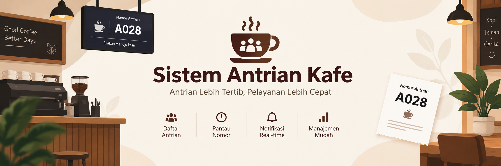

<p align="center">
  
</p>

<h1 align="center">☕ Sistem Antrian Kafe</h1>

<p align="center">
  <b>Algoritma dan Struktur Data (ADT, Inheritence, LinkedList)</b><br>
  Aplikasi manajemen antrian kafe berbasis konsol menggunakan Java dengan 3 variasi Linked List.
</p>

<p align="center">
  
  
  
</p>

---

## 📌 Daftar Isi
- [Tentang Proyek](#-tentang-proyek)
- [Konsep Struktur Data & PBO](#-konsep-struktur-data--pbo)
- [Struktur Proyek](#-struktur-proyek)
- [Prasyarat](#-prasyarat)
- [Panduan Instalasi & Eksekusi](#-panduan-instalasi--eksekusi)
- [Alur & Fitur Program](#-alur--fitur-program)
- [Demonstrasi Output](#-demonstrasi-output)
- [Anggota Tim](#-anggota-tim)

---

## 📖 Tentang Proyek

**Sistem Antrian Kafe** adalah aplikasi simulasi antrian kasir kafe yang dirancang untuk mendemonstrasikan penerapan konsep **Abstract Data Type (ADT)**, **Inheritance**, **Polymorphism**, serta tiga variasi struktur data **Linked List** dalam studi kasus dunia nyata:
1. **Antrian Reguler** – Menggunakan **Single Linked List** (FIFO standar).
2. **Antrian VIP** – Menggunakan **Double Linked List** (mendukung traversal maju dan mundur).
3. **Antrian Takeaway** – Menggunakan **Circular Linked List** (siklus rotasi pesanan cepat).

---

## 🧠 Konsep Struktur Data

### 1. Perbandingan Struktur Antrian

| Kategori Antrian | Tipe Linked List | Struktur Node | Arah Traversal | Karakteristik Utama |
| :--- | :--- | :--- | :---: | :--- |
| **REGULER** | Single Linked List (SLL) | `data`, `next` | Maju | Pointer `head` di awal antrian dan `tail` di akhir. |
| **VIP** | Double Linked List (DLL) | `data`, `prev`, `next` | Maju & Mundur | Bisa melihat antrian dari depan maupun dari belakang. |
| **TAKEAWAY** | Circular Linked List (CLL) | `data`, `next` | Melingkar | Pointer `tail.next` selalu menunjuk kembali ke `head`. |

<details>
<summary><b>🔍 Klik di sini untuk melihat rincian konsep OOP yang digunakan</b></summary>

- **Abstract Data Type (ADT)**: Kelas abstrak [`AntrianKafe`](src/model/AntrianKafe.java) mendefinisikan operasi dasar antrian seperti `tambahPelanggan()`, `hapusPelanggan()`, `tampilkanAntrian()`, dan `apakahKosong()`.
- **Inheritance**: Subclass [`SingleLinkedList`](src/model/SingleLinkedList.java), [`DoubleLinkedList`](src/model/DoubleLinkedList.java), dan [`CircularLinkedList`](src/model/CircularLinkedList.java) mewarisi kelas basis `AntrianKafe`.
- **Polymorphism**: Program utama mengelola tipe antrian yang berbeda menggunakan referensi superclass yang seragam (`AntrianKafe`).
- **Encapsulation**: Data pelanggan dienkapsulasi dalam kelas [`Pelanggan`](src/model/Pelanggan.java) dengan atribut `private` dan akses kontrol via getter.
</details>

---

## 📂 Struktur Proyek

```text
Sistem-Antrian-Kafe/
├── assets/
│   └── banner.png              # Banner visual proyek
├── src/
│   ├── model/                  # Logika struktur data & entitas
│   │   ├── AntrianKafe.java        # Abstract base class (ADT)
│   │   ├── Pelanggan.java          # Entitas data pelanggan & generator nomor
│   │   ├── SingleLinkedList.java   # Implementasi antrian Reguler
│   │   ├── DoubleLinkedList.java   # Implementasi antrian VIP
│   │   └── CircularLinkedList.java # Implementasi antrian Takeaway
│   └── main/                   # Titik masuk program
│       └── Main.java               # Menu interaktif & runner simulasi
├── bin/                        # Direktori output kompilasi bytecode (.class)
├── .gitignore
└── README.md
```

---

## ⚙️ Prasyarat

- **Java Development Kit (JDK)**: Versi 8 atau yang lebih baru.
- **Terminal / Command Prompt / PowerShell**.

---

## 🚀 Panduan Instalasi & Eksekusi

### 1. Kompilasi Program
Buka terminal di root direktori proyek, lalu jalankan perintah:

```bash
javac -d bin src/model/*.java src/main/*.java
```

### 2. Menjalankan Program

Pilih salah satu mode di bawah ini:

#### 🔹 Mode A: Menu Interaktif (Input Manual Kasir)
```bash
java -cp bin main.Main
```

#### 🔹 Mode B: Demonstrasi Otomatis (Demo Cepat)
```bash
java -cp bin main.Main --demo
```

---

## 🎯 Alur & Fitur Program

Program dilengkapi menu interaktif di terminal dengan fitur:
- `[1]` **Tambah Pelanggan Baru**: Input nama, nomor HP, dan pesanan ke kategori yang dipilih. Nomor antrian digenerate otomatis:
  - `REGULER-001`, `REGULER-002`, ...
  - `VIP-100`, `VIP-101`, ...
  - `TAKEAWAY-200`, `TAKEAWAY-201`, ...
- `[2]` **Panggil / Layani Pelanggan (FIFO)**: Melayani pelanggan yang berada di urutan terdepan.
- `[3]` **Tampilkan Semua Antrian**: Melihat status antrian aktif dari ketiga kategori.
- `[4]` **Lihat VIP dari Belakang**: Fitur traversal mundur khusus Double Linked List.
- `[5]` **Simulasi Otomatis**: Menjalankan skenario pengujian 4 tahap dari penambahan sampai antrian dilayani.
- **Clear Screen**: Layar terminal otomatis dibersihkan setiap kali berganti menu agar tampilan rapi.

---

## 💻 Demonstrasi Output

<details open>
<summary><b>📺 Contoh Output Eksekusi Mode Simulasi (Klik untuk Buka/Tutup)</b></summary>

```text
========================================
     DEMONSTRASI SIMULASI OTOMATIS
========================================

>>> TAHAP 1: Menambah Pelanggan Awal
[*] Memuat data awal antrian:
[+] Masuk antrian REGULER : [REGULER-001] Wildan | HP: 081234567890 | Pesanan: Kopi
[+] Masuk antrian REGULER : [REGULER-002] Bintang | HP: 081234567891 | Pesanan: Susu
[+] Masuk antrian VIP     : [VIP-100] Isam | HP: 081234567892 | Pesanan: Latte
[+] Masuk antrian TAKEAWAY: [TAKEAWAY-200] Topan | HP: 081234567893 | Pesanan: Sandwich

>>> TAHAP 2: Kondisi Antrian Saat Ini
=== DAFTAR ANTRIAN: REGULER (Single Linked List) ===
1. [REGULER-001] Wildan | HP: 081234567890 | Pesanan: Kopi
2. [REGULER-002] Bintang | HP: 081234567891 | Pesanan: Susu
Total Antrian: 2 orang

=== DAFTAR ANTRIAN: VIP (Double Linked List) ===
1. [VIP-100] Isam | HP: 081234567892 | Pesanan: Latte
Total Antrian: 1 orang

=== DAFTAR ANTRIAN: TAKEAWAY (Circular Linked List) ===
1. [TAKEAWAY-200] Topan | HP: 081234567893 | Pesanan: Sandwich
Total Antrian: 1 orang

>>> TAHAP 3: Melayani Pelanggan Terdepan (FIFO)
[-] Melayani pelanggan (FIFO): [REGULER-001] Wildan | HP: 081234567890 | Pesanan: Kopi
[-] Melayani pelanggan (FIFO): [VIP-100] Isam | HP: 081234567892 | Pesanan: Latte
[-] Melayani pelanggan (FIFO): [TAKEAWAY-200] Topan | HP: 081234567893 | Pesanan: Sandwich

>>> TAHAP 4: Kondisi Antrian Setelah Dilayani
=== DAFTAR ANTRIAN: REGULER (Single Linked List) ===
1. [REGULER-002] Bintang | HP: 081234567891 | Pesanan: Susu
Total Antrian: 1 orang

=== DAFTAR ANTRIAN: VIP (Double Linked List) ===
[ Antrian kosong ]
Total: 0 orang

=== DAFTAR ANTRIAN: TAKEAWAY (Circular Linked List) ===
[ Antrian kosong ]
Total: 0 orang

========================================
       SIMULASI OTOMATIS SELESAI
========================================
```
</details>

---

## 👥 Anggota Tim

| No | Nama Anggota | Peran / Data Awal Antrian |
| :-: | :--- | :--- |
| 1 | **Wildan** | Antrian Reguler 01 |
| 2 | **Bintang** | Antrian Reguler 02 |
| 3 | **Isam** | Antrian VIP 100 |
| 4 | **Topan** | Antrian Takeaway 200 |

---

<p align="center">
  <b>Algortima dan Struktur Data</b> © 2026
</p>
